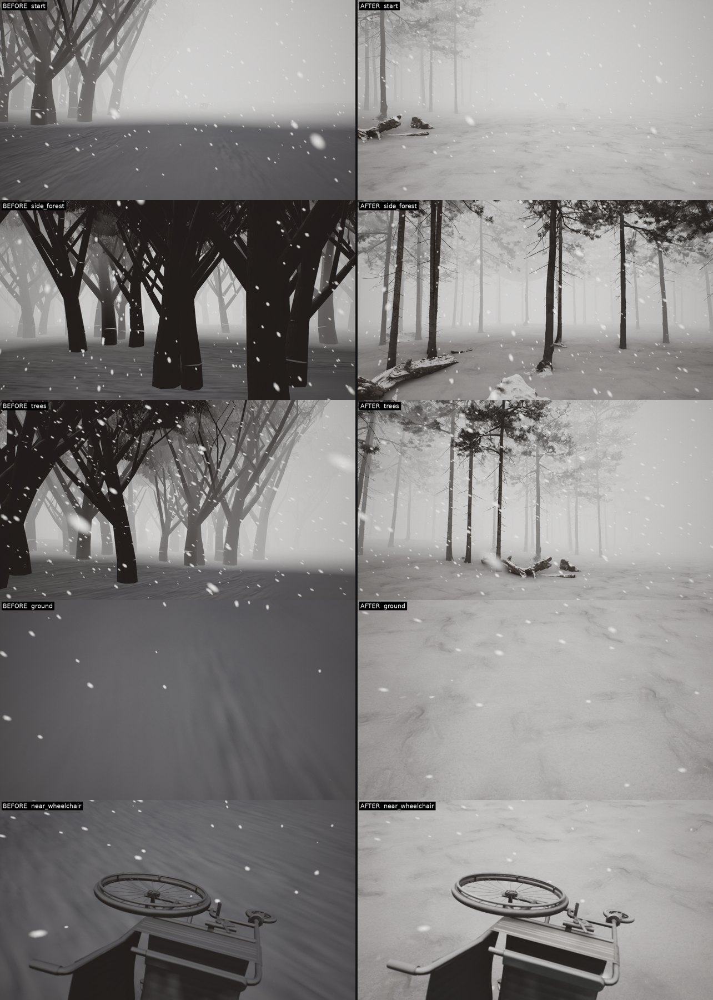

# L_Blizzard — first photoreal pass (issue #1)

The first 60 seconds of Snowfall, rebuilt as a walkable scanned environment instead of the WebGL export's
procedural trees. Everything here was produced by the automated pipeline on the RTX 2080 / i9-9900K / 32 GB machine,
in UE 5.8 (uncooked `-game`, 1080p unless noted). **Before** = the original level regenerated from the export
(`contentStages=levels,noart`, tag `bf2`). **After** = the same level with the art layer (tag `af5`; frame times from `nn1`).

| | |
|---|---|
| Matched views (8) | `pair_*.jpg` — start, trees, edge_trunk, side_forest, back, ground, wheelchair, near_wheelchair |
| 60 s walk, before \| after | [`walk_before_after.mp4`](walk_before_after.mp4) — the real pawn on a scripted path: walk, look into the forest, approach the wheelchair, look down, turn 180°, walk on, look up into the canopy |
| 60 s walk, after (720p) | [`walk_after_720p.mp4`](walk_after_720p.mp4) |
| Asset provenance | [`provenance_assets.json`](provenance_assets.json) (every file URL, CC0) · [`art_layer_build_record.json`](art_layer_build_record.json) (what the build placed) |

## What changed (implemented)

* **Art layer** `unreal/Content/Data/Art/L_Blizzard.json` (versioned, v2). Applied by `sf_art.py` inside the normal
  content build, so `sf_build_all` regenerates the same improved level every time (seeded placement; counts were
  identical across 6 regenerations: 312 + 35 pines, 11 + 4 deadwood, 25 rocks, 45 branch clusters, 348 trunk colliders).
* **Trees:** the export's procedural trunks/twigs (meshes m0–m4, m6–m10) are suppressed and replaced by Poly Haven's
  photoscanned Scots pine (3 trees, 4.2–7.0 M triangles each, geometric needles) plus scanned dead trunks, stumps,
  moss rocks and dry branches. Dense forest on the left, sparse on the right, the road and memorial spots kept clear.
  *Creative decision taken without you:* the bare deciduous silhouettes became snowy pines — the only photoreal CC0
  trees available. Reversible by editing the JSON.
* **Ground:** world-aligned 4K snow scan (`snow_02`), with its tiled dark footprint marks painted out by
  `Tools/art/prepare_assets.py` (`snow_02_clean`, recorded in the JSON), macro variation, Nanite tessellation.
* **Light:** overcast forest HDRI (`snowy_forest`), softer sun (source angle 12°).
* **Snow on objects:** logs/rocks/stumps carry snow; the wheelchair's snow coat was reduced (0.85 → 0.3) because it hid
  the chair's metal and fabric.
* **Bugs found by the moving-view evidence and fixed:** the 2 km sky sphere still collided, so the player spawned on top of
  the sky (Z = +2000 m) in every playthrough; the first piece of every pine had no Nanite data and was drawn ~350× on the
  classic path (60 ms/frame); snowflakes brushing the lens; the drifting mist cards I added read as grey discs, so they are
  off by default (`-mist`).
* **Tooling:** `-walkcapture` (scripted walk of the real pawn, every frame saved, mp4), `-walkperf` (same walk, real time,
  frame times), `-walkprofile` (ProfileGPU), `-walkcvars`, shot retry/resume after a crash, a watchdog for hung crash
  handlers, art imports split across editor processes (a 7 M-triangle tree does not fit in one import on 32 GB).

## Demonstrated (looked at in the actual UE output)

* Matched stills: forest depth layers into the fog, readable bark/needles up close, snow-settled logs and rocks, fresh
  powder instead of a flat grey ground (`pair_*.jpg`).
* 60 s walk: no tree, rock or collider blocks the path (61.0 m travelled before and after, and the same 31 low-speed frames
  in both — the walk's start-up, not obstacles).
* Regeneration: the level was rebuilt from the JSON 6 times (tags af…af5, nn1) with identical placement counts. A from-scratch rebuild with the imported assets deleted was not done.

## Frame time (60 s walk, 1920×1080, uncooked `-game`, no screenshots)

| | avg | p95 | worst |
|---|---|---|---|
| before (`bf2`) | 11.7 ms | 13.3 ms | 1.1 s (first-frame hitch) |
| after, first build (`af3`) | 40.5 ms | 126 ms | 3.9 s |
| after, Nanite fixed (`nn1`) | 15.5 ms | 20.9 ms | 1.4 s (first-frame hitch) |

## Not done / not tested — explicitly

* **Shadow figure (pre-existing bug, present in the before level too):** the story's dark figure 15 m ahead is normally
  not visible at all, and every few seconds it renders as a screen-sized black ellipse (see the walk at 8–9 s, 12 s, 15 s).
  Isolated to the `SFFigure` actor (hiding it removes the ellipse; it is not motion blur, the flakes, the mist or the
  player's own body). The character imports at 1/100 scale and is scaled ×126 at runtime; the fix is in progress.
* Not compiled into a cooked/packaged build; the `package` stage was not run. The full autoplay of the story
  (`play` stage) was not run for this change. Audio was not checked. Only `L_Blizzard` was regenerated; the other six
  levels still have the sky-collision bug until they are rebuilt.
* The "after" stills and walk come from `af5` (before the Nanite fix); the fix changes speed, not the image.
* The wheelchair is Poly Haven's model, but its metal still reads matte grey up close — next pass.
* Shot runs crash intermittently with Windows out-of-memory/`DEVICE_REMOVED` while the PC is in use (the verify script
  retries and resumes); the local Zen cache reports "Insufficient Storage".
* No custom 3D modelling was needed (all scanned CC0 assets), so Text-to-CAD was not used.
