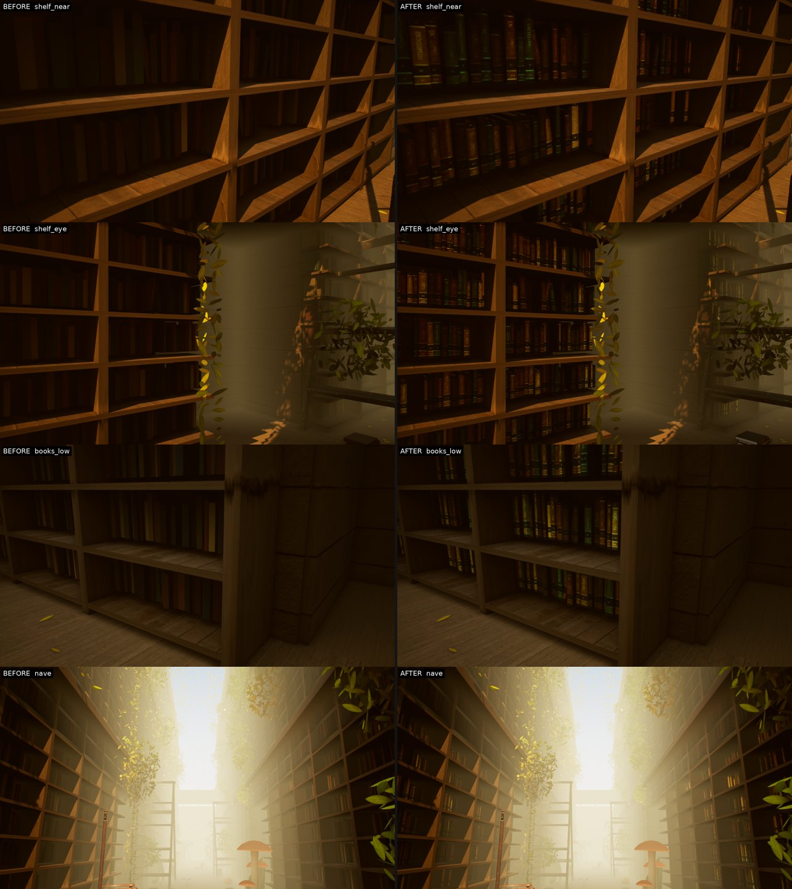

# L_Library — scanned books, original mood kept

After L_Blizzard the feedback was that the original (WebGL-derived) mood beat the photoreal pass. So this pass keeps
env, fog, lights and grading exactly as exported and replaces only what reads as procedural up close.

**Before** = `contentStages=levels,noart` (tag `lb0`), **after** = art layer v2 (tag `lb2`), same cameras.

## What changed

* `unreal/Content/Data/Art/L_Library.json` (v2): the 8439 book boxes on the shelves and the 31 lying books are replaced
  by Poly Haven's scanned `book_encyclopedia_set_01` (20 separate books, CC0). Each book is fitted to its box
  (position, size, tilt), spines turned to the aisle.
* Colour follows the WebGL art direction: the export's 8439 per-book colours were clustered into 8 leather tints
  (tint = cluster colour / the scan's mean cover colour, normalised to the scan's brightness). v1's six invented tints
  all read brown.
* `sf_art.py`: generic `replace` (export instances -> scanned asset, box-fitted) and tinted material instances.
* Bug found by the walk capture and fixed in `sf_levels.py`: the 13 400 daisy-stem planes in the meadow had collision,
  so after waking the player could not walk (3.7 m in 60 s; 45 m after the fix). Any scatter of >= 5000 instances is
  now non-colliding.

## Not done / not tested

* Shelves, ladders, plants, mushrooms, the upper (fogged) shelves and the meadow are unchanged; the shelf boards still
  read as plain boxes with a wood texture.
* No packaged build, no full story playthrough, sound not checked.
